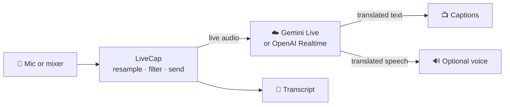

<p align="center">
  
</p>

<h1 align="center">LiveCap</h1>

<p align="center">
  <b>Live speech translation, as captions you can put on a big screen.</b><br>
  Someone speaks Korean — the room reads English a few seconds later.<br>
  Press one key and it goes the other way.
</p>

<p align="center">
  
  
  
  
  
  
</p>

<p align="center">
  <a href="docs/setup-macos.md"></a>
  &nbsp;
  <a href="docs/setup-windows.md"></a>
  &nbsp;
  <a href="https://github.com/dennis2lee/live-translation/releases"></a>
</p>

<p align="center">
  
</p>

---

## 🎯 What it is for

A sermon, a conference talk, a meeting with a guest who does not share your
language. Plug the mixer into the laptop, put LiveCap full screen on the
projector, press **`0`**. The speaker does nothing different.

<table>
  <tr>
    <td width="33%" valign="top">
      <h3>📺 Built for the back row</h3>
      Large text in a box that never jumps. The newest line stays in the same
      place, and lines arrive at reading pace instead of in bursts.
    </td>
    <td width="33%" valign="top">
      <h3>🔊 Or listen to it</h3>
      The translation can be spoken aloud, in the model's voice or a voice
      installed on the computer. Press <code>m</code> to mute the
      translation — captions and speech — any time.
    </td>
    <td width="33%" valign="top">
      <h3>♾️ Built for long sessions</h3>
      Sessions are renewed behind the scenes. The next one is warmed up
      unheard and switched in during a pause between sentences.
    </td>
  </tr>
  <tr>
    <td valign="top">
      <h3>🎵 Skips the music</h3>
      An on-device classifier holds back songs and instrumentals, so a
      worship set or a video clip is not translated.
    </td>
    <td valign="top">
      <h3>🔑 Two engines</h3>
      Google Gemini Live or OpenAI Realtime Translate, chosen in Preferences.
      Your key, your account, your bill — no middleman server.
    </td>
    <td valign="top">
      <h3>📝 Every word kept</h3>
      Each session is saved as a timestamped Markdown transcript, with
      reconnects marked where they happened.
    </td>
  </tr>
</table>

## ⚙️ How it works



The cloud model listens to the audio stream and translates as it goes — no
push-to-talk, no waiting for a sentence to end. LiveCap does everything
around it: clean audio in, steady captions out, and a connection that stays up
for hours.

## 🚀 Get started in three steps

| | |
|:---:|---|
| **1** | **Download** the latest build from [Releases](https://github.com/dennis2lee/live-translation/releases) — `macos-arm64.zip` or `x64.msi`. |
| **2** | **Get an API key** from [Google AI Studio](https://aistudio.google.com/apikey) or [OpenAI](https://platform.openai.com/api-keys), with billing turned on. |
| **3** | **Paste it** into **Preferences → API**, press **Test Key**, then press **`0`**. |

The full walkthroughs cover the one-time security prompt both systems show for
an unsigned app, microphone permission, and what to do if something is off:
**[🍎 macOS guide](docs/setup-macos.md)** · **[🪟 Windows guide](docs/setup-windows.md)**

## ✨ Highlights

| | |
|---|---|
| ⚡ **Fast** | First caption in about 3 s with Gemini; OpenAI's first translated speech arrives in under a second. |
| 🔁 **Seamless reconnects** | Gemini ends a session about every nine minutes (LiveCap renews an OpenAI session itself, every 50). The replacement is opened early, fed the same audio unheard, and switched in a pause after the same sentence in both. Measured on Gemini: the silence at a reconnect fell from 2.4–3.6 s to 0.5–1.2 s — an ordinary pause between sentences. |
| 🎚️ **Cleaner speech** | Removes a buzzing artifact the cloud model produces at the start of a session — found and measured with signal processing on recorded model audio. |
| 🎵 **Music filter** | A pure-Go port of Google's YAMNet audio classifier, running on the device. No audio leaves the machine for it. |
| 🔤 **Readable captions** | Fixed box, bottom-aligned text, paced line release, an optional "complete phrases only" mode, clear-on-silence, and every colour and size adjustable. |
| 🔒 **Your key stays yours** | Kept in an encrypted file (which deters casual reading, but anyone with the app can decrypt it) or in the system keychain — never in a settings file, never in a log, never in a URL. |
| 🪶 **Native and small** | Go and Fyne. One app, no Electron, no Python, no runtime to install. |

## 🤝 Choosing a provider

| |  |  |
|---|---|---|
| Model | `gemini-3.5-live-translate-preview` | `gpt-realtime-translate` |
| First translated speech | 3.3–5.2 s | ~0.5 s |
| Spoken voice | picked by the model, changes at each reconnect | follows the speaker's voice (whether it holds across reconnects is not yet measured) |
| Name / jargon hints | ✅ | — |
| Cost | ~$0.037 per minute (measured: $1.11 for 30 min) | $0.034 per minute (OpenAI's list price) |

You pay the provider directly; LiveCap has no account and no server of its
own. Set a budget alert with whichever you use.

<details>
<summary><b>⌨️ Keyboard</b></summary>

| Key | Action |
|---|---|
| `0` | Start / stop translating |
| `1` | Korean → English |
| `2` | English → Korean |
| `9` | Complete phrases only |
| `f` | Full screen |
| `m` | Mute the translation — captions and speech |
| `⌘R` / `Ctrl+R` | Start translating |
| `⌘,` / `Ctrl+,` | Preferences |

On macOS the keys work with the Korean input source too (`m` and `f` are read
by key, so the input method cannot hold them back); on Windows, switch to
English with 한/영 first. Mute is also in the **Translate** menu. A dot beside the caption
box shows the connection: grey idle, green blinking connecting, green live,
red error (with the reason printed). Half of it turns deep red while the
translation is muted.

</details>

## 🔬 Measured, not guessed

Every constant that affects what you see or hear came from a measurement, and
the measurement is written down next to it.

- **Caption pacing** comes from the timing of 93 real fragments: the model
  answers on a one-second beat, so the idle timeout is 1.6 s, not 1.2.
- **The music filter's** thresholds come from scoring speech against backing
  music at known levels, and its output was checked against Google's
  reference interpreter.
- **The reconnect switch** was tuned on recorded sessions. Two sessions
  translating the same speech rarely fall silent together for half a second,
  and a fresh OpenAI session runs a sentence ahead of the old one — so the
  switch waits until both are 200 ms into a pause after the *same* sentence,
  compared by character bigrams and by their numbers.
- **Audio changes** were verified with signal processing on recorded model
  output, and every change goes through adversarial review and mutation
  testing — defects planted on purpose to prove the tests catch them.

## 🚧 Honest limits

- **Windows** has been installed and run on a real PC (August 2026, version
  1.0), but this release's additions — OpenAI, warm handover, the Windows
  voices — **have not been run on Windows**.
- Builds are **not code-signed or notarized**; both systems ask once before the
  first launch (the setup guides walk through it).
- Mac builds are **Apple silicon only** and need **macOS 26 or later**.
- The buzz removal covers the start of a session; a similar artifact at the end
  of an old session is left alone, because every attempt to cut it also cut a
  word.
- OpenAI's endpoint accepts no vocabulary hints, and its limit on session
  length has not been measured.

<details>
<summary><b>🛠️ Building from source</b></summary>

Requires Go 1.26 on macOS. The Windows installer cross-builds from the Mac.
Building it yourself for your own noncommercial use is allowed; distributing
the result, or a changed version, is not — see the license below.

```bash
git clone https://github.com/dennis2lee/live-translation.git
cd live-translation/src_go
./run.sh                          # run from source
go test ./...                     # the whole suite, offline — no key needed
./packaging/build_app.sh          # dist/LiveCap.app, with a self-test
./packaging/build_windows.sh      # dist/windows/LiveCap-<version>-x64.msi
```

```
src_go/
├── cmd/livecap/        entry point, --selftest
└── internal/
    ├── audio/          capture, playback, the ring buffers, the freeze filter
    ├── captions/       fragments → display lines (no UI, no network)
    ├── classify/       the on-device music classifier
    ├── config/         settings and per-provider API keys
    ├── translator/     Gemini and OpenAI sessions, reconnects, warm handover
    ├── tts/            local voices (macOS `say`, Windows SAPI)
    └── ui/             caption view, menus, Preferences
```

Measurement programs live in `src_go/spikes/`; their findings are in
[`src_go/spikes/RESULTS.md`](src_go/spikes/RESULTS.md).

</details>

## 📜 License

**Source available — not open source.** LiveCap is published under the
[PolyForm Strict License 1.0.0](LICENSE). In plain terms (the license text is
what counts):

| | |
|---|---|
| ✅ | Read and study the source code. |
| ✅ | Use LiveCap for **noncommercial** purposes — personal use, study, religious observance, and use by charities, schools, research and public bodies. |
| ❌ | **Commercial use.** |
| ❌ | **Redistributing** it, in source or built form. |
| ❌ | **Changing it**, or building new works on it, without permission. |

Want to do something the license does not allow? Ask:
<a href="mailto:dennis2.lee@gmail.com">dennis2.lee@gmail.com</a>.

---

<p align="center">
  <sub>Copyright © 2026 Pyeongwoo Lee. All rights reserved except as granted in the <a href="LICENSE">LICENSE</a>.</sub>
</p>
