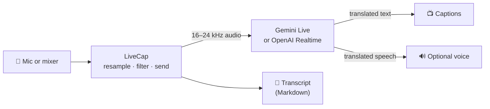

<div align="center">

# LiveCap

**Live speech translation, as captions you can put on a big screen.**

Someone speaks Korean — the room reads English, a few seconds later.
Flip one key and it goes the other way.

macOS · Windows · Google Gemini or OpenAI

[Set up on a Mac](docs/setup-macos.md) · [Set up on Windows](docs/setup-windows.md) · [Releases](https://github.com/dennis2lee/live-translation/releases)

</div>

---

## What it is for

A sermon, a conference talk, a meeting with a guest who does not share your
language. Plug the mixer into the laptop, put LiveCap full screen on the
projector, press **0**. The speaker does nothing different.

- **Captions built for reading from across a room.** Large text, a fixed box
  that does not jump around, the newest line always in the same place, lines
  released at reading pace instead of in bursts.
- **Or hear it.** The translation can be spoken aloud, in the model's voice or
  a voice installed on the computer.
- **It keeps going.** Sessions are replaced behind the scenes every few
  minutes; the new one is warmed up in advance and switched in during a pause,
  so the listener does not hear the seam.
- **One key per job.** `0` start/stop, `1` Korean→English, `2` English→Korean,
  `f` full screen, `m` mute. Works with the Korean keyboard layout too.

## How it works



The cloud model listens to the audio stream and translates as it goes — there
is no "press to talk", no waiting for the end of a sentence. LiveCap's job is
everything around it: clean audio in, steady captions out, and keeping the
connection alive for hours.

## Highlights

| | |
|---|---|
| **Two engines** | Google `gemini-3.5-live-translate-preview` or OpenAI `gpt-realtime-translate`, chosen in Preferences. Captions behave the same with either. |
| **Fast** | First caption in about 3 s with Gemini; OpenAI's first translated speech arrives in under a second. |
| **Seamless reconnects** | The provider ends a session about every nine minutes. LiveCap opens the replacement early, feeds it the same audio unheard, and switches in a shared pause. Measured: the silence at a reconnect fell from 2.4–3.6 s to under 0.8 s. |
| **Music filter** | An on-device classifier (a pure-Go port of Google's YAMNet) holds back songs and instrumental music, so a worship set or a video clip is not translated. |
| **Cleaner speech** | Removes a buzzing artifact the cloud model produces at the start of a session, measured and verified with signal processing, not by ear alone. |
| **Readable captions** | Fixed box, bottom-aligned text, paced line release, optional "complete phrases only" mode, clear-on-silence, every colour and size adjustable. |
| **Transcripts** | Every session saved as Markdown with timestamps, reconnects marked inline. |
| **Your key stays yours** | Stored encrypted (or in the system keychain), never in a settings file, never in a log, never in a URL. |
| **Native** | Go and Fyne. One small app, no Electron, no Python, no runtime to install. |

## Get started

1. **Download** the latest build from
   [Releases](https://github.com/dennis2lee/live-translation/releases) —
   `macos-arm64.zip` or `x64.msi`.
2. **Get an API key** from [Google AI Studio](https://aistudio.google.com/apikey)
   or [OpenAI](https://platform.openai.com/api-keys), with billing turned on.
3. **Paste it** into **Preferences → API**, press **Test Key**, then press
   **0**.

The full walkthroughs, including the security prompts both systems show for an
unsigned app, are here:

- 🍎 **[macOS setup guide](docs/setup-macos.md)**
- 🪟 **[Windows setup guide](docs/setup-windows.md)**

## Choosing a provider

| | Google Gemini | OpenAI |
|---|---|---|
| Model | `gemini-3.5-live-translate-preview` | `gpt-realtime-translate` |
| First translated speech | 3.3–5.2 s | ~0.5 s |
| Spoken voice | picked by the model, changes at each reconnect | follows the speaker |
| Name / jargon hints | ✅ | — |
| Cost | ~$0.037 per minute | ~$0.034 per minute |

A 30-minute session costs about **$1.10** either way. You pay the provider
directly; LiveCap has no account and no server of its own.

## Keyboard

| Key | Action |
|---|---|
| `0` | Start / stop translating |
| `1` | Korean → English |
| `2` | English → Korean |
| `9` | Complete phrases only |
| `f` | Full screen |
| `m` | Mute the spoken translation |
| `⌘R` / `Ctrl+R` | Start translating |
| `⌘,` / `Ctrl+,` | Preferences |

A dot in the corner of the caption box shows the connection: grey idle, green
blinking connecting, green live, red error (with the reason printed). Half of
it turns deep red while the speech is muted.

## Measured, not guessed

Every constant in LiveCap that affects what you see or hear came from a
measurement, and the measurement is written down next to it:

- Caption pacing comes from the timing of 93 real fragments: the model answers
  on a one-second beat, so the idle timeout is 1.6 s, not 1.2.
- The music filter's thresholds come from scoring speech against backing music
  at known levels, and its output was checked against Google's reference
  interpreter.
- The reconnect switch was tuned on recorded sessions. Two sessions
  translating the same speech rarely fall silent together for half a second,
  and a fresh OpenAI session runs a sentence ahead of the old one — so the
  switch waits until both are 200 ms into a pause after the *same* sentence,
  compared by character bigrams.
- Audio changes were verified with signal processing — spectral and
  periodicity measurements on recorded model output — and with mutation
  testing: defects are planted in the code on purpose to prove the tests catch
  them.

## Honest limits

- **Windows** builds and installs cleanly in testing but **has not yet been run
  on a real Windows PC** by its author.
- Builds are **not code-signed or notarized**; both systems ask once before the
  first launch (the setup guides walk through it).
- Mac builds are **Apple silicon only**.
- The buzz removal covers the start of a session; a similar artifact at the end
  of an old session is left alone, because every attempt to cut it also cut a
  word.
- OpenAI's endpoint accepts no vocabulary hints, and its limit on session
  length has not been measured.

## Building from source

Requires Go 1.26 on macOS. The Windows installer cross-builds from the Mac.

```bash
git clone https://github.com/dennis2lee/live-translation.git
cd live-translation/src_go
./run.sh                          # run from source
go test ./...                     # the whole suite, offline — no key needed
./packaging/build_app.sh          # dist/LiveCap.app, with a self-test
./packaging/build_windows.sh      # dist/windows/LiveCap-<version>-x64.msi
```

```
src_go/
├── cmd/livecap/        entry point, --selftest
└── internal/
    ├── audio/          capture, playback, the ring buffers, the freeze filter
    ├── captions/       fragments → display lines (no UI, no network)
    ├── classify/       the on-device music classifier
    ├── config/         settings and per-provider API keys
    ├── translator/     Gemini and OpenAI sessions, reconnects, warm handover
    ├── tts/            local voices (macOS `say`, Windows SAPI)
    └── ui/             caption view, menus, Preferences
```

Measurement programs live in `src_go/spikes/`; their findings are in
[`src_go/spikes/RESULTS.md`](src_go/spikes/RESULTS.md).

## License

Copyright © 2026 Pyeongwoo Lee. All rights reserved.

Proprietary — not open-source software. No permission is granted to use, copy,
modify or distribute it without prior written permission. See
[LICENSE](LICENSE).

Contact: Pyeongwoo Lee — <dennis2.lee@gmail.com>
